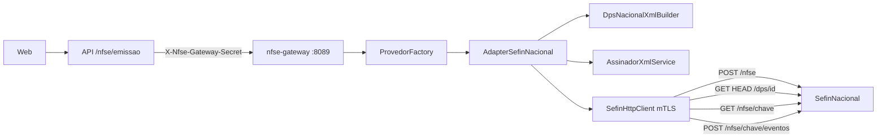

# Contrato do AdapterSefinNacional

## Decisões

- O identificador do provedor é `sefin_nacional`, que cabe no `varchar(20)` de `nfseconfiguracao.provedor`. A mudança não precisa de migration.
- O adapter implementa o `NfseProvedorAdapter` atual, com `enviarLoteSincrono`, `cancelar` e `consultarPorRps`. As rotas do gateway (`/nfse/emissao`, `/nfse/cancelar` e `/nfse/consultar-rps`) e o client Node continuam iguais.
- O adapter não herda de `AbstractAbrasfAdapter`, que é acoplado a SOAP. A assinatura XMLDSig sai para um service compartilhado, sem mudar o comportamento da Betha.
- A substituição fica fora desta entrega. A API bloqueia essa ação para `sefin_nacional` com uma mensagem clara.
- A chave de acesso de 50 dígitos continua gravada em `codigoautenticidadenfse`. A API já usa esse campo como chave no cancelamento DPS, ver [api/src/service/nfse-emissao/cancelar-nfse.ts](api/src/service/nfse-emissao/cancelar-nfse.ts).



## Contrato interno: gateway para API

A entrada continua igual: `configJson`, `pfxBase64`, `senha` e `payloadNfse`, ou `dados` no caso de consulta e cancelamento.

A saída normalizada, comum a emissão, consulta e cancelamento, fica assim:

```php
[
  'sucesso' => bool,
  'chaveAcesso' => ?string,       // 50 dígitos
  'codigoVerificacao' => ?string, // = chaveAcesso, para manter compatibilidade com a API atual
  'numeroNfse' => ?string,        // nNFSe extraído do XML da NFS-e
  'idDps' => ?string,             // 45 chars (DPS + mun + tpInsc + doc + serie + nDPS)
  'xml' => ?string,               // NFS-e ou evento já descompactado
  'xmlEnviado' => ?string,        // DPS ou pedido de evento assinado
  'erros' => [['codigo' => string, 'mensagem' => string]], // descricao + complemento
  'alertas' => [['codigo' => string, 'mensagem' => string]],
  'pendente' => bool,             // true só em timeout/falha de rede depois do POST
  'provedor' => 'sefin_nacional',
  'versaolayout' => 'dps-1.01',
  'modo' => 'dps',
]
```

Os `dados` de cada operação:

- `consultarPorRps` recebe `{ idDps?, chaveAcesso? }`. Se houver chave, chama `GET /nfse/{chave}`. Se não houver, chama `GET /dps/{idDps}` e depois `GET /nfse/{chave}`.
- `cancelar` recebe `{ chaveAcesso, motivo, codigoMotivo, prestador.cnpj }` e chama `POST /nfse/{chave}/eventos` com o evento `e101101`.

Mapeamento de status HTTP da Sefin:

- 201: sucesso.
- 400: rejeição, com `erros[]`.
- 403: certificado inválido, que vira um erro de configuração.
- 404 em `/dps`: a NFS-e não foi gerada.
- 500 ou timeout: `pendente=true` com `idDps`, para a API reconsultar.

URL base por ambiente, que pode ser sobrescrita com `configJson.urlwsdl`:

- Ambiente 2: `https://sefin.producaorestrita.nfse.gov.br/SefinNacional`
- Ambiente 1: `https://sefin.nfse.gov.br/SefinNacional`

## Gateway PHP (`api_Nfe/nfse-gateway`)

1. Extrair `assinarXml` de [src/Services/AbstractAbrasfAdapter.php](api_Nfe/nfse-gateway/src/Services/AbstractAbrasfAdapter.php) para `src/Services/AssinadorXmlService.php`. A classe abstrata passa a delegar para esse service, e `tests/AdapterBethaTest.php` continua passando.
2. Criar `src/Sefin/SefinHttpClient.php`:
   - curl com TLS 1.2 e o certificado de cliente vindo do PFX, convertido para PEM em arquivos temporários com permissão 0600 e apagados no `finally`;
   - timeout de 60 s;
   - helpers `gzipBase64(string)` e `gunzipBase64(string)`;
   - métodos `post(path, json)`, `get(path)` e `head(path)`, que retornam `{status, json}`.
3. Criar `src/Sefin/DpsNacionalXmlBuilder.php`. A base é a lógica de `montarXmlDps` em [src/Adapters/AdapterBetha.php](api_Nfe/nfse-gateway/src/Adapters/AdapterBetha.php), nas linhas 1012 em diante, que já faz Id de 45 chars, `cTribNac`, `cNBS`, `opSimpNac` e omissão do IBSCBS para empresas do Simples. O builder usa o namespace nacional `http://www.sped.fazenda.gov.br/nfse`, sem prefixo (o prefixo causa a rejeição E1228), e a Signature fica como filha de `DPS`.
4. Criar `src/Sefin/EventoNacionalXmlBuilder.php` para o `pedRegEvento`/`e101101`. A base é `montarXmlEventoCancelamentoDps` do adapter Betha, sem o envelope SOAP e no namespace nacional.
5. Criar `src/Adapters/AdapterSefinNacional.php`. Ele orquestra builder, assinatura, gzip, client HTTP e normalização da resposta. Também extrai `nNFSe` do XML devolvido. Em resposta duplicada ou timeout, faz `HEAD`/`GET /dps/{id}` antes de declarar falha.
6. Registrar `'sefin_nacional' => new AdapterSefinNacional()` em [src/Factory/ProvedorFactory.php](api_Nfe/nfse-gateway/src/Factory/ProvedorFactory.php).
7. Adicionar o XSD oficial nacional (DPS v1.01 e evento) em `docs/sefin-nacional/`. O `nfse_dps_v01.xsd` atual usa o namespace da Betha e não serve para isso.
8. Criar `tests/AdapterSefinNacionalTest.php`, no mesmo estilo do teste da Betha, cobrindo:
   - Id DPS com 45 chars;
   - XML sem prefixo e válido contra o XSD nacional;
   - ida e volta de gzip;
   - mapeamento das respostas 201, 400 e 404 a partir de fixtures JSON.
9. Documentar em `docs/provedores/sefin-nacional.md`, [docs/provedores/README.md](api_Nfe/nfse-gateway/docs/provedores/README.md) e no README do gateway.

## API Node (`api/`)

- [api/src/constants/nfse-emissao.ts](api/src/constants/nfse-emissao.ts): adicionar `sefin_nacional` em `NFSE_PROVEDORES` e o rótulo "Sefin Nacional (Emissor Público)".
- [api/src/util/validar-pre-requisitos-emissao-nfse.ts](api/src/util/validar-pre-requisitos-emissao-nfse.ts):
  - criar o helper `isProvedorSefinNacional`;
  - `isLayoutNfseDps` passa a considerar esse provedor;
  - para esse provedor, deixar de exigir WSDL;
  - adicionar pendência se a série estiver fora do intervalo 1 a 49999.
- [api/src/service/nfse-emissao/preparar-payload-emissao-nfse.ts](api/src/service/nfse-emissao/preparar-payload-emissao-nfse.ts): `layoutDps` vale `true` quando o provedor é `sefin_nacional`.
- [api/src/model/nfse-emissao-model.ts](api/src/model/nfse-emissao-model.ts): incluir `chaveAcesso`, `idDps` e `alertas` na resposta do gateway, e `idDps` em `DadosEmissaoNfseSalvos`.
- [api/src/service/nfse-emissao/emitir-nfse.ts](api/src/service/nfse-emissao/emitir-nfse.ts):
  - a nota é autorizada quando `sucesso && chaveAcesso`;
  - a nota fica pendente quando `pendente && idDps`, e nesse caso a mensagem pede para consultar;
  - gravar `idDps`;
  - adequar a mensagem de E050, que hoje cita a Betha.
- [api/src/service/nfse-emissao/consultar-nfse.ts](api/src/service/nfse-emissao/consultar-nfse.ts): para `sefin_nacional`, enviar `{ idDps, chaveAcesso }`, sem exigir protocolo.
- [api/src/service/nfse-emissao/retransmitir-nfse.ts](api/src/service/nfse-emissao/retransmitir-nfse.ts): para `sefin_nacional`, consultar o `idDps` anterior antes de reservar um novo nDPS. Se a NFS-e já existir, reconciliar em vez de emitir de novo.
- [api/src/service/nfse-emissao/substituir-nfse.ts](api/src/service/nfse-emissao/substituir-nfse.ts): retornar 400 com a mensagem "substituição Sefin Nacional ainda não suportada".
- O cancelamento já trata resposta síncrona (`pendente=false`, que leva a CANCELADA) e só precisa de teste.
- Testes vitest: pré-requisitos e mapeamento da emissão com o gateway mockado (autorizada, rejeitada e pendente).

## Web (`web/`)

- [web/src/constants/nfse-emissao.ts](web/src/constants/nfse-emissao.ts): incluir a opção do novo provedor.
- [web/src/app/(auth)/configuracoes/components/nfse-configuracao-form.tsx](web/src/app/(auth)/configuracoes/components/nfse-configuracao-form.tsx): com `sefin_nacional`, esconder os campos WSDL e URLs por operação, fixar `versaolayout` em `dps-1.01`, mostrar a URL base por ambiente com override opcional e um aviso sobre o certificado com "Autenticação Cliente".
- Detalhe da NFS-e em `web/src/app/(auth)/nota-fiscal-servico/[id]/page-client.tsx`: exibir a chave de 50 dígitos e esconder "Substituir" quando o provedor for `sefin_nacional`.

## Validação

1. Rodar `php tests/AdapterSefinNacionalTest.php` e `php tests/AdapterBethaTest.php`, para confirmar que a Betha não regrediu.
2. Rodar os testes vitest da API e da web.
3. Fazer um smoke test manual em produção restrita com um certificado A1 de teste: emitir, depois `GET /dps/{id}`, depois `GET /nfse/{chave}`, depois cancelar.
4. Rodar `npm run check` na raiz.